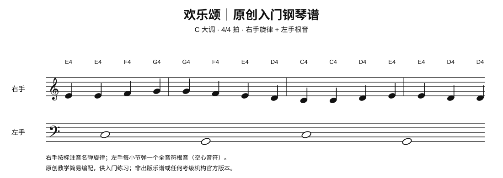

# 二级｜稳定节奏与双手配合

| 曲目 | 作曲家/来源 | 练习目标 |
|---|---|---|
| G大调小步舞曲 BWV Anh. 114 | 传统归于巴赫，现多认为佩措尔德 | 舞曲风格、声部平衡 |
| g小调小步舞曲 BWV Anh. 115 | 佩措尔德 | 小调色彩、分句 |
| 欢乐颂双手编配 | 贝多芬主题 | 旋律与低音协调 |
| 致爱丽丝主题（简化版） | 贝多芬 | 旋律突出；原版更难 |
| 土耳其进行曲主题（简易改编） | 莫扎特 | 轻快节奏 |
| 卡农（初级改编） | 帕赫贝尔 | 重复和声 |
| 天空之城主题（简易版） | 久石让 | 歌唱性旋律 |
| 菊次郎的夏天主题（简易版） | 久石让 | 重复节奏型 |
| 送别双手简易版 | 常见歌曲版本 | 旋律与伴奏 |
| 春之歌（简易版） | 门德尔松主题 | 连贯旋律 |
| 铃儿响叮当双手版 | J. L. Pierpont | 节奏稳定 |
| 车尔尼 Op. 599 进阶选曲 | 车尔尼 | 手指均匀 |
| 巴斯蒂安教程相应级别选曲 | 巴斯蒂安系列 | 读谱与风格 |
| 小奏鸣曲简易选段 | 克莱门蒂等 | 乐句与结构 |
| 小星星变奏主题（简易版） | 莫扎特主题 | 主题变化 |

练习重点：右手旋律清楚，左手伴奏不抢音量；合手不稳时先降低速度。

## 已附钢琴谱（SVG）

### 欢乐颂双手编配（入门简化版）

当前文件是适合入门练习的原创简化版，不等同于本表中其他曲目的完整编配。其余曲目暂未附谱，后续按批次补充；不再附外部乐谱检索链接。
